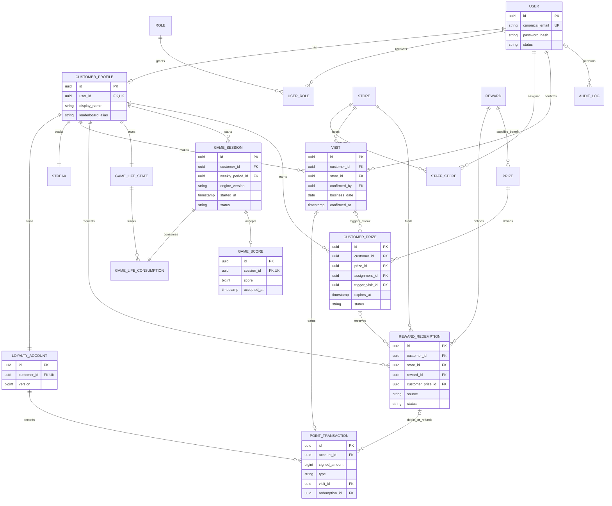
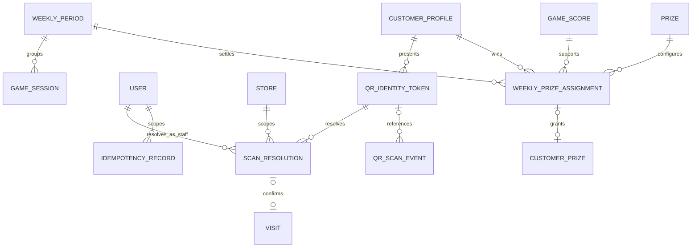

# Domain model and entity relationships

Completes [issue #5](https://github.com/amiraharcs/Loyalty/issues/5).
Status: conceptual production model; these are not existing database tables.
The rules in [business rules](business-rules.md) and the boundaries in
[roles and permissions](roles-and-permissions.md) govern this model.

## Module boundaries

Use packages by business responsibility inside one Spring Boot application:

| Module | Owns | Collaborates through |
| --- | --- | --- |
| Identity | User, Role, UserRole, CustomerProfile, authenticated sessions | Principal/customer lookup and account-status checks |
| Stores | Store and StaffStore assignment | Assigned-store permission checks |
| Loyalty | LoyaltyAccount, Visit, PointTransaction and Streak | Confirmed-visit service and balance query |
| QR | QrIdentityToken, ScanResolution and QrScanEvent | Customer identity resolution, never direct points writes |
| Rewards | Reward and RewardRedemption | Transactional loyalty debit/refund and prize reservation |
| Game | GameLifeState, GameLifeConsumption, GameSession and GameScore | Lives/session commands and accepted-score queries |
| Competition | WeeklyPeriod, Prize, WeeklyPrizeAssignment and CustomerPrize | Accepted scores and entitlement creation |
| Audit | AuditLog | Append-only event service, admin read projections |

Only a module's services change its entities. Other modules use service methods
or read projections rather than reaching into repositories to bypass invariants.
Cross-module operations such as visit + points or redemption + debit run in one
database transaction in this modular monolith. Emit audit events in that same
transaction when they describe a successful mutation.

## Core entity catalogue

Use UUID primary keys unless a shared owner primary key is specified. Use UTC
instants for timestamps and a separate date for loyalty qualification.

| Entity | Important fields | Relationship and invariant |
| --- | --- | --- |
| User | `id`, canonical email, password hash, status, created/updated times | Unique canonical email; multiple explicit UserRole grants; no stored plaintext password. |
| Role / UserRole | Role code; `userId`, `roleCode` | Only CUSTOMER/STAFF/ADMIN values; unique grant pair; no SYSTEM role exposed to users. |
| CustomerProfile | `id`, unique `userId`, display name, leaderboard alias/privacy preference | One per customer user; identity/profile is separate from points/game state. |
| LoyaltyAccount | `id`, unique `customerId`, version, created time | One per customer; serialises ledger mutations; any cached balance must match the ledger. |
| Store | `id`, name, status, address | Active stores accept operations; history retains references to inactive stores. |
| StaffStore | `staffUserId`, `storeId`, active flag, assignedBy, timestamps | Unique pair; staff role and active assignment required for service operations. |
| Visit | `id`, customer/account/store/staff IDs, businessDate, confirmedAt, earnedPoints snapshot | One qualifying visit per customer/date; confirmed records are immutable. |
| PointTransaction | `id`, accountId, signedAmount, type, visitId/redemptionId as applicable, actorId, reason, createdAt, reversalOfId | Immutable ledger; EARN/REDEMPTION/REFUND/ADJUSTMENT; each source/reversal used at most once. |
| Reward | `id`, name, description, pointCost, active flag, availability interval | Nonnegative integer cost; catalogue deactivation preserves redemption history. |
| RewardRedemption | `id`, customerId, storeId, rewardId, optional customerPrizeId, source, benefit/cost snapshot, status, expiresAt, fulfilledBy/At | Source is POINTS or PRIZE; state machine and ledger/reservation updates are atomic. |
| Streak | `customerId` (shared PK), currentCount, longestCount, lastQualifyingDate, version | Derived projection of visits; read-time display may expire without deleting historical values. |
| GameLifeState | `customerId` (shared PK), version | Lockable aggregate per customer; lives/next recharge are computed from unexpired consumptions. |
| GameLifeConsumption | `id`, customerId, unique sessionId, consumedAt, rechargeAt | Exactly one per accepted game start; rechargeAt = consumedAt + two hours. |
| GameSession | `id`, customerId, startedAt, expiresAt, completedAt, status, engineVersion, weeklyPeriodId | ACTIVE/COMPLETED/EXPIRED; one active session per customer; version fixes score-validation rules. |
| GameScore | `id`, unique sessionId, integer score, acceptedAt | Customer and period follow the session; at most one accepted score per session. |
| Prize | `id`, name, benefit type/value, rewardId, trigger type, active flag | Catalogue definition for weekly/streak benefits; never represents cash. |
| CustomerPrize | `id`, customerId, prizeId, assignmentId or triggerVisitId, benefit snapshot, status, awardedAt, expiresAt | AVAILABLE/RESERVED/REDEEMED/EXPIRED/REVOKED; one entitlement per unique trigger; one live reservation. |
| AuditLog | `id`, actorUserId nullable, actorType, action, targetType/Id, storeId nullable, occurredAt, requestId, safe metadata | Append-only; internal jobs use SYSTEM actorType with no fake user; never contains tokens/passwords. |

## Core ER diagram

Optional source foreign keys distinguish earned, redeemed and adjusted ledger
entries; they do not mean every transaction belongs to every relationship.
Source/type constraints must enforce the appropriate combination. A prize may
have multiple historical cancelled redemption attempts, but only one PENDING
or FULFILLED redemption may reserve/spend it.

## Supporting workflow entities

| Entity | Fields and purpose |
| --- | --- |
| QrIdentityToken | Random `jti`, customerId, issuedAt, expiresAt, signature key ID, status. Its signed payload exposes no email/balance; store revocation/consumption state and never log the token. |
| ScanResolution | ID, tokenJti, customerId, staffUserId, storeId, expiresAt, consumedAt. Bound to one staff/store; consumed in the visit transaction, not by identity lookup. |
| QrScanEvent | ID, tokenJti nullable, staff/store IDs, occurredAt, result/reason, requestId. Records resolution/confirmation attempts, including failures, without the raw token. |
| WeeklyPeriod | ID, local startDate, startAt/endAt UTC, settlementCutoffAt, status. Immutable boundaries calculated with Europe/London; status OPEN/SETTLED. |
| WeeklyPrizeAssignment | ID, periodId, customerId, rank, scoreId, prizeId, benefit snapshot, assignedAt, optional supersedesId. Stores the settlement outcome independently of mutable catalogue data. |
| IdempotencyRecord | Actor ID, operation/key, request hash, resource/result reference, createdAt, expiresAt. Unique actor+operation+key; protects retried mutations. No raw password, session or QR payload is stored. |

## Constraints and indexes to implement with Flyway

- Unique canonical email, role grant, customer user, loyalty account owner and
  staff-store pair. Index staff assignments by active user/store.
- Unique customer/businessDate on qualifying Visit; unique Visit earning source
  on PointTransaction. Restrict valid source fields by transaction type.
- Index ledger by accountId/createdAt/id; use `BIGINT` for amounts and totals.
  API values must stay within JavaScript's safe-integer range, checked before
  an operation commits. No floating-point points or client-supplied balance.
- One debit and at most one refund per redemption; `reversalOfId` unique when
  present. The account lock prevents insufficient-balance races.
- Unique accepted score and life consumption per GameSession. A partial unique
  index on ACTIVE session/customer combines with the GameLifeState lock; expire
  stale sessions transactionally before creating another.
- Index consumptions by customerId/rechargeAt and scores by period/customer,
  score and accepted time. No denormalised leaderboard row is the source of truth.
- Unique weekly period start. Original settlement assignments are unique by
  period/rank and period/customer. Audited corrections have explicit supersedes
  links and a single effective head; never overwrite original assignments.
- Unique prize trigger for each streak visit/prize/customer and each assignment.
  Lock the entitlement and use a partial unique live-redemption constraint.
- Index token jti/expiry, scan staff/store/time and audit actor/target/time. Keep
  failure events distinguishable from successful transactional events.

## Transaction and lifecycle boundaries

| Operation | Atomic changes and locks |
| --- | --- |
| Register | User, CUSTOMER role, CustomerProfile, LoyaltyAccount, Streak, GameLifeState; email uniqueness constraint resolves a race. |
| Confirm visit | Lock token/resolution and account; Visit, EARN entry, streak and optional entitlement; consume resolution/token; append successful scan/audit event. |
| Redeem points | Lock account; balance check, PENDING redemption and REDEMPTION entry, audit. |
| Redeem prize | Lock entitlement; check expiry, PENDING redemption, RESERVED entitlement and audit. |
| Fulfil/cancel/expire | Lock redemption and relevant account/entitlement; exactly one terminal state, optional unique refund/release, actor/time and audit. |
| Start game | Lock GameLifeState; expire stale session, calculate availability, create session and consumption; never refund failed abandoned runs. |
| Submit score | Lock owned session; validate ACTIVE/version/time, create score, complete session; exact retry returns prior score. |
| Settle week | Lock WeeklyPeriod; stable snapshot, assignments, entitlements and SETTLED flag; retries return existing settlement. |

Prize-backed redemptions expire at the earlier of 24 hours after reservation or
the entitlement's expiry. Fulfilment checks this deadline inside the locked
transaction; a reservation cannot extend a prize's lifetime. Catalogue edits
do not revoke a valid existing snapshot.

Use one consistent lock ordering for operations needing several aggregates:
customer account/life state first, entitlement second, redemption/session third.
Do not call remote services while holding these database locks. Batch scheduled
work in bounded transactions and retry transient conflicts safely.

Historical users, stores, rewards and prizes are deactivated rather than deleted.
Use restrictive foreign keys for visits, transactions, accepted scores, benefits
and audit references; do not cascade-delete earned history. Privacy/retention
work can anonymise profile fields separately without rewriting business events.

Idempotency records and failed security events need explicit retention jobs.
They are infrastructure/support data, not substitutes for ledger or visit history.
External side effects should use an outbox if introduced later; none are required
for the initial single-database workflows.
