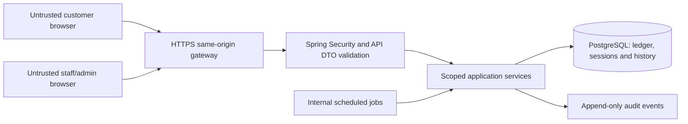

# Security and testing strategy

Completes [issue #7](https://github.com/amiraharcs/Loyalty/issues/7).
Status: production v1 design and verification plan. It does not make the current
browser-only demo secure or claim that the planned test suites already exist.
Read with the [authorisation matrix](roles-and-permissions.md), [business rules](business-rules.md),
[domain model](domain-model.md) and [API conventions](api-conventions.md).

## Trust boundaries and threat model

The browser can change storage, clocks, routes, requests and game code. Frontend
guards and disabled buttons provide UX only. The backend owns identity, roles,
store assignment, visits, points, rewards, lives, accepted scores and periods.
Resource IDs and QR possession alone do not grant a staff/admin role.

Threats include credential stuffing, stolen sessions, CSRF/XSS, IDOR, staff
misuse, QR replay, concurrent/double redemptions, repeated game starts, forged
scores and secret exposure through logs. There is no payment-processing boundary.

## Authentication strategy

Use Spring Security with opaque server-side sessions persisted through Spring
Session JDBC/PostgreSQL. Production uses the same-origin gateway defined in the
API document. Keep session IDs in the Secure/HttpOnly/SameSite=Lax host-only
cookie; do not store authentication tokens or passwords in browser storage.

Rotate the session identifier on login/privilege changes. Invalidate it on logout,
password changes or account deactivation. Enforce a 30-minute idle timeout and
12-hour absolute maximum; the server decides expiry. A protected API returns
JSON `401`, not an HTML redirect. The frontend fetches `/auth/me` on startup to
learn its real identity; a remembered name or email cannot restore a session.

Registration grants CUSTOMER only and creates an empty loyalty account. Use
case-insensitive canonical email uniqueness and generic credential/conflict
responses to limit account discovery. Passwords are never returned or logged.
v1 password policy: 15–128 characters, no silent trimming/truncation, support
spaces/Unicode, and reject known compromised/common passwords where practical.

Use Spring's password-encoder abstraction with Argon2id (minimum 19 MiB memory,
two iterations, parallelism one), unique encoder-managed salt and versioned
encoding. Benchmark on the deployment hardware before rollout; increase cost
when feasible and rehash on successful login when policy changes. BCrypt is not
silently substituted without documenting its input-length and cost policy.
These initial hashing parameters follow the [OWASP Password Storage Cheat Sheet](https://cheatsheetseries.owasp.org/cheatsheets/Password_Storage_Cheat_Sheet.html).

Keep CSRF protection enabled for every unsafe browser request, including login,
registration and logout. Bootstrap a token from `/auth/csrf`, keep it in memory,
send `X-CSRF-TOKEN`, and obtain a fresh token after authentication/logout. Use
Spring's supported SPA handling for deferred tokens and masking. SameSite is
additional protection, not a substitute for CSRF validation. See [Spring Security's SPA CSRF guidance](https://docs.spring.io/spring-security/reference/servlet/exploits/csrf.html).

Protect login with per-account and per-IP rate limits; use generic responses and
do not create a permanent account-lockout denial of service. Initial limits are
10 failed logins/15 minutes per account/IP combination, plus an independent
IP budget, and 10 registrations/hour/IP. Tune against measured legitimate use.
Trust forwarded addresses only from the configured reverse proxy.

## Authorisation and operational security

Every protected request checks active user state and explicit roles. Application
services check resource ownership and current staff-store assignment, regardless
of whether the URL was reachable or a React control was visible. Do not keep
stale role/assignment authority inside a long-lived client token.

Apply allowlisted DTOs, bounded body sizes, Bean Validation, parameterised queries
and constrained filter/sort values. Never bind a JPA entity directly from JSON.
Enforce the last-admin safeguard under a shared lock so two concurrent role
changes cannot remove both remaining administrators. Staff self-service visits
and redemption fulfilments are denied.

Use least-privilege application database credentials; migration credentials are
separate from request-serving access where the host supports it. Configure secrets
through deployment environment/secret storage. QR signing keys, database passwords
and session credentials never enter Vite variables or committed `.env` files.

Log server-generated request IDs, action codes, safe IDs and outcomes. Redact
Cookie, Authorization, CSRF, password, raw QR and personal lookup values in
application/proxy logs. Successful privileged business mutations and their audit
records commit together. Failed attempts need security events outside a rolled-back
business transaction, with safe correlation data. Logs do not grant authority.

Production should set security headers at the gateway: MIME sniffing protection,
strict referrer policy and a tested CSP with self-hosted scripts/fonts/media,
no object embeds and no unneeded third-party connections. The current React UI
uses inline style attributes, so its style policy must account for those without
allowing unsafe scripts. Configure permitted frame ancestors deliberately if
the hosting platform requires embedding. Enable HSTS once HTTPS/domain operation
is verified; do not break intended development or embedding by copying an untested
header policy. Never disable TLS certificate verification in application code.

## QR security model

The QR is a temporary identity reference, not a balance, coupon, password or
payment token. Issue a signed JWS using a maintained library and a fixed HS256
allowlist with a securely generated >=256-bit server key. Validate signature
before claims and reject `none`, algorithm substitution, unknown key IDs and
untrusted issuer/audience. Key IDs select only the configured verification ring.

Payload: fixed issuer/audience, issuedAt, expiresAt and a cryptographically random
nonce `jti`. Resolve the customer through the server's token record, not exposed
email or browser-supplied customer claims. Validity is 60 seconds on the server
clock. An issued replacement revokes the prior live token and unused resolutions.
Keep retired verification keys only for their short validity window; rotate
active signing keys through trusted configuration.

Only active assigned staff can resolve a token for a store. Return limited service
data plus a two-minute ScanResolution bound to that staff/store. Resolution does
not award points or consume the token. A token valid at resolution may support
that resolution until its own two-minute deadline, even if the original display
token's 60 seconds elapse; explicit revocation still cancels it.

Confirmation checks the resolution, bound identities, revocation, duplicate-date
constraint and account state under locks, then consumes the resolution and token
with the Visit/points transaction. Replays cannot create another award. A manual
lookup has its own audited, scoped resolution and the same daily qualification
checks, never a hidden way around visit rules.

Limit issuance initially to 30/minute/customer and resolution to 60/minute/staff,
with additional IP budgets. Store safe `jti` references and outcomes for scan
history, never the complete encoded token. Do not cache QR responses or put
tokens into request URLs that leak through access logs/referrers.

## Game abuse assumptions and controls

The backend trusts its own GameSession/life records, not localStorage. Serialize
starts with a per-customer state lock, allow one active run, consume a life once,
and enforce server expiry. Accept one integer score per owned valid session.
Apply engine-version-specific plausibility ceilings and rate limits; retries
cannot replace a lower accepted score with a higher forged one.

Scores remain client-reported. Without deterministic server replay/telemetry,
plausibility checks cannot prove honest play or prevent all bots. v1 explicitly
accepts this limitation for non-cash coffee-shop benefits. Prize launch requires
calibrated bounds, auditable settlement, suspicious-score review and documented
moderation decisions. Do not call a client nonce or signature generated in
JavaScript an anti-cheat secret.

Store rejected submissions as safe security events; exclude them from rankings.
Staff/admin account holders are excluded from prize-eligible competition. A
corrected assignment is an audited superseding record, not an overwritten score.

## Test strategy

| Layer | Scope and representative assertions | Planned tooling |
| --- | --- | --- |
| Unit | Streak/day calculations, per-life recharge, score plausibility, rank tie-breaks, ownership/store policies, expiry/cancellation rules and DTO validation. | JUnit with injected Clock; Vitest for frontend pure logic. |
| Repository/migration | Empty PostgreSQL migration; foreign keys, partial/unique constraints, ledger totals, ranking queries and restrictive history deletion. | JUnit + Testcontainers PostgreSQL; Flyway. |
| API integration | Full Spring context, actual Security filters, cookie/CSRF lifecycle, role/ownership checks, valid/invalid DTOs and consistent problem responses. | Spring Boot tests/MockMvc + PostgreSQL; no mocked security for acceptance paths. |
| Transaction/concurrency | Rollback between visit and ledger writes; simultaneous daily scans, overspending redemptions, final-life starts, score duplicates, weekly settlement and last-admin changes. | Integration tests with synchronised parallel callers and independent transactions. |
| Frontend component | Loading/failure states, balance updates, sheet focus/Escape, login expiry, no-life state and failed score-submission recovery. | Vitest + React Testing Library with mocked API responses. |
| End-to-end | Customer registration/login; staff QR -> visit -> points -> streak; customer redemption -> staff fulfilment; game life -> accepted score -> rank; forbidden admin access. | Playwright against an isolated backend/database; role-specific browser contexts. |
| Security | CSRF omission/mismatch; session fixation/expiry; IDOR; role injection; stale store grants; account enumeration; QR tamper/replay; score/life tampering; secret/log/header checks. | Automated adversarial API tests plus focused pre-release review. |
| Visual/device | Prototype comparison at 320px/390px/1440px, focus/text enlargement, safe areas, touch/tilt permission, 60/120 Hz timing. | Playwright captures plus real Android/iOS checks. |

### Critical acceptance cases

1. Registration cannot set STAFF/ADMIN or starter points; disabled accounts cannot
   regain access through an existing session.
2. Missing/wrong CSRF blocks mutation without a database change. A login rotates
   the session identifier and refreshes CSRF; logout invalidates the old session.
3. Customer A cannot retrieve/mutate B's resource, including replaying B's
   idempotency key. Staff cannot act at an unassigned store or serve themselves.
4. A tampered, expired, superseded, reused or foreign-audience QR is rejected;
   staff/store-bound resolution cannot be reused by another actor.
5. Duplicate/concurrent daily confirmations create exactly one Visit/EARN entry;
   injected transaction failure rolls both back. DST and midnight cases use dates.
6. Concurrent redemptions never produce a negative balance; cancel/expiry issues
   one refund; fulfilled or expired prizes cannot be spent again.
7. Three lives recharge independently at their two-hour boundaries; concurrency
   cannot create a fourth or a second active run; abandoning never refunds a life.
8. Session ownership/expiry, duplicate scores and plausibility limits protect
   rankings; tie order is stable and settlement reruns grant no extra benefits.
9. Every admin adjustment/configuration change has safe actor/reason/correlation
   metadata; credentials and raw QR values never appear in logs or error bodies.
10. Tests use valid authentication/CSRF before asserting a permission denial,
    so an earlier unrelated filter failure cannot falsely prove authorisation.

## Fixtures, CI and release gates

Use isolated disposable PostgreSQL databases and synthetic identities. Fixtures
must include two customers, two stores, independently assigned staff and an admin,
plus disabled and combined-role accounts. Inject time and random seeds where
possible; never rely on sleeps to prove recharge, expiry or weekly boundaries.
Concurrency tests coordinate entry into competing transactions explicitly.

Backend CI should run unit/API/repository/concurrency tests and migrate an empty
database. Frontend CI should run lint, typecheck/production build, logic/component
tests and critical Playwright journeys. Keep browser visual baselines separate
from business-rule assertions so a moving mascot frame does not fail a transaction
test. Exact dependency/CI setup belongs to P2/P10/P11 implementation issues.

Release requires passing critical flows and denied-access cases, documented
limits, a secret/configuration review and real-device checks for tilt. Add a
regression test for each discovered business/security defect. Use risk-based
coverage rather than asserting a percentage proves security.

### What exists today

`frontend/package.json` has `npm run build` and `npm run lint`. Previous browser
and game-physics checks were ad-hoc validation, not a committed CI test suite.
There is no Spring backend, real authentication, database, trusted QR, reward
transaction or server score verification yet. This phase documents the required
tests; it does not mark later test/security implementation issues complete.

## Related guidance

- [OWASP Authorization Cheat Sheet](https://cheatsheetseries.owasp.org/cheatsheets/Authorization_Cheat_Sheet.html): request/resource checks and denial by default.
- [OWASP REST Security Cheat Sheet](https://cheatsheetseries.owasp.org/cheatsheets/REST_Security_Cheat_Sheet.html): TLS, validated inputs and restricted data exposure.
- [OWASP Authentication Cheat Sheet](https://cheatsheetseries.owasp.org/cheatsheets/Authentication_Cheat_Sheet.html): credential abuse and safe authentication responses.
- [Spring Security CSRF reference](https://docs.spring.io/spring-security/reference/servlet/exploits/csrf.html): browser/SPA request protection.
